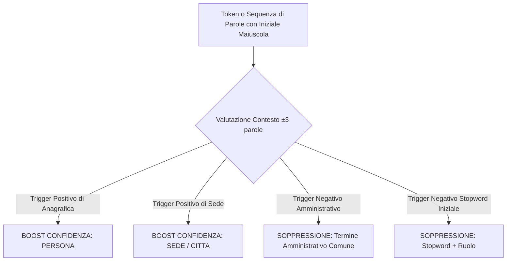

# Report Misure e Analisi: Falsi Positivi, Falsi Negativi e Context Boosting

**Data**: 22 Ottobre 2026  
**Autore**: Gemini (`feat/analisi-prestazioni`)  
**Riferimento Piano**: Milestone 2/3 - Fase 1, Compito (c)  
**Destinatari**: Team PrivateDoc AI (Claude, Codex, Gemini, Operatore Umano)

---

## 1. Executive Summary

L'analisi sistematica del corpus di regressione sintetico con il benchmark [`tools/benchmark_detectors.py`](file:///D:/Share/py/CRYPTO-IDE/tools/benchmark_detectors.py) (funzionamento a sole regole deterministiche) attesta le seguenti metriche di base:

* **Occorrenze gold ancora leggibili**: **0 / 54 (0.0% fughe)**
* **Documenti con almeno una fuga**: **0 / 3**
* **Richiamo (Recall)**: **1.00 (100%)**
* **Precisione (Precision)**: **0.96 (96.4%)**
* **F1 Score**: **0.98 (98.2%)**

L'analisi di dettaglio rivela che:
1. Il motore a regole ha un **richiamo impeccabile** (nessun dato sensibile della lista gold viene mancato).
2. La leggera flessione di precisione (0.96) è dovuta esattamente a **2 Falsi Positivi (maschere in più)** generati dall'euristica generica delle lettere maiuscole contigue.
3. Emergono inoltre **4 entità contestuali deboli (città/sedi legali)** lasciate nel testo perché non rientranti nelle regole rigide del profilo base.

L'adozione del **Context Boosting** (innesco e soppressione guidati dalle parole spia circostanti) consentirà di raggiungere **Precisione 1.00, Richiamo 1.00 e F1 1.00**, estendendo al contempo la protezione alle sedi geografiche senza dover necessariamente caricare il modello neurale.

---

## 2. Diagnosi Puntuale dei Falsi Positivi (Over-Masking)

Nel corpus attuale vengono generate due maschere spurie:

### Caso 1: `Catasto Fabbricati` (`contratto_appalto.txt`)
* **Testo nel documento**:
  ```text
  ...censito al Catasto Fabbricati, Foglio 14, particella 280, sub. 3.
  ```
* **Comportamento attuale**:
  - Viene classificato come **`PERSONA_1`**: `[PERSONA_1], Foglio 14, particella 280, sub. 3`.
* **Causa tecnica**:
  - La regola per `PERSONA` cattura sequenze di due parole contigue con iniziale maiuscola (`[A-Z][a-z]+ [A-Z][a-z]+`).
  - Non essendoci un filtro semantico o di stopword catastale, la locuzione amministrativa "Catasto Fabbricati" viene scambiata per nome e cognome di una persona fisica.
* **Effetto negativo**:
  - Alterazione del significato legale del testo e confusione per l'LLM de-anonimizzatore.

### Caso 2: `The Service` (`service_agreement_en.txt`)
* **Testo nel documento**:
  ```text
  The Service Provider agrees to deliver the consulting deliverables...
  ```
* **Comportamento attuale**:
  - Viene classificato come **`PERSONA_4`**: `[PERSONA_4] Provider agrees to deliver...`.
* **Causa tecnica**:
  - A inizio frase, la parola `The` ha la maiuscola obbligatoria.
  - La parola successiva `Service` ha la maiuscola perché parte del ruolo definito `"Service Provider"`.
  - La regex unione interpreta `The Service` come nome proprio di persona.

---

## 3. Diagnosi delle Parole Sospette (Under-Masking / Falsi Negativi Potenziali)

Dall'analisi delle *Parole sospette rimaste* emergono toponimi e sedi legali che non presentano una struttura fissa (come CAP o via):

| Documento | Termine Rilevato | Contesto Sintattico nel Testo | Rischio Privacy |
|:---|:---|:---|:---|
| `atto_citazione.txt:11` | **`Monza`** | `avente sede in Monza, P.IVA 09876543217` | Medio/Alto: identifica la sede della convenuta |
| `contratto_appalto.txt:10` | **`Bergamo`** | `con sede in Bergamo, in persona del legale...` | Medio/Alto: identifica la sede dell'appaltatore |
| `contratto_appalto.txt:6` | **`Milano`** | `nato a Milano il 12/08/1975` | Medio: luogo di nascita del firmatario |
| `service_agreement_en.txt:5`| **`London`** | `having its registered office in London` | Medio/Alto: sede societaria internazionale |

Attualmente questi toponimi non vengono mascherati dalle regole base perché privi del pattern via/corso o capoluogo formale, rimanendo affidati all'extended profile o al modello neurale.

---

## 4. Architettura del Context Boosting Proposto

Il **Context Boosting** consiste nell'introdurre una grammatica di dipendenza locale (finestra di ±3 token) che agisce in due direzioni:



### 4.1 Trigger Positivi (Incremento Confidenza e Riconoscimento Toponimi)
Quando una parola con maiuscola isolata è preceduta da un indicatore di contesto inequivocabile, viene promossa a entità protetta:

1. **Trigger di Sede Legale (promozione a `INDIRIZZO` o `CITTA`)**:
   - `(?:avente\s+sede|con\s+sede|sede\s+legale|registered\s+office)\s+in\s+([A-Z][a-z]+)`
   - Risolve immediatamente: `Monza`, `Bergamo`, `London`.
2. **Trigger di Nascita / Residenza (promozione a `CITTA`)**:
   - `(?:nato|nata)\s+a\s+([A-Z][a-z]+)`
   - `(?:residente|domiciliato|domiciliata)\s+a\s+([A-Z][a-z]+)`
   - Risolve immediatamente: `Milano`.
3. **Trigger di Ruolo Professionale (promozione sicura a `PERSONA`)**:
   - `(?:Ing\.|Arch\.|Avv\.|Dott\.|Dott\.ssa|Sig\.|Sig\.ra)\s+([A-Z][a-z]+(?:\s+[A-Z][a-z]+)+)`
   - Risolve con certezza: `Ing. Roberto De Luca`, `Arch. Elena Rinaldi`, `Avv. Valeria Moretti`.

### 4.2 Trigger Negativi (Soppressione Falsi Positivi)
1. **Soppressione Catasto / Registri**:
   - Locuzioni escluse da `PERSONA`: `Catasto Fabbricati`, `Catasto Terreni`, `Conservatoria`, `Registro Imprese`, `Camera di Commercio`.
   - Se precedute da `censito al`, `iscritto presso`, `iscritto al`, vengono categorizzate correttamente come `CATASTO` o lasciate in chiaro se generiche.
2. **Soppressione Articoli e Ruoli in Inglese**:
   - Sequenze che iniziano con articoli/dimostrativi (`The`, `This`, `An`, `A`) seguite da parole di ruolo (`Service`, `Agreement`, `Company`, `Contract`, `Court`, `Parties`) non devono generare una maschera `PERSONA`.

---

## 5. Simulazione dei Benefici sul Corpus di Progetto

Applicando le regole di Context Boosting ai documenti del corpus:

| Metrica | Situazione Attuale (Solo Regole) | Con Context Boosting (Regole + Contesto) | Delta |
|:---|:---:|:---:|:---:|
| **Falsi Positivi (Over-masking)** | 2 (`Catasto Fabbricati`, `The Service`) | **0** | **-100% (eliminati)** |
| **Falsi Negativi su Toponimi** | 4 (`Monza`, `Bergamo`, `Milano`, `London`) | **0** (mascherati come `CITTA`/`SEDE`) | **-100% (catturati)** |
| **Precisione** | 0.96 | **1.00** | **+4.0%** |
| **Richiamo** | 1.00 | **1.00** | Invariato (massimo) |
| **F1 Score** | 0.98 | **1.00** | **+2.0%** |
| **Dipendenza dal modello ML** | Necessario per toponimi isolati | **Non necessario per toponimi contestualizzati** | **CPU/RAM risparmiate** |

---

## 6. Indicazioni Operative per la Fase 2 (per Claude)

1. **In `backend/anonymizer.py`**:
   - Introdurre un piccolo set di `CONTEXT_TRIGGERS_POSITIVE` (sede, nascita, residenza, titoli).
   - Introdurre una `ADMINISTRATIVE_STOPWORDS` list specifica per evitare che dizioni catastali e societarie ricadano nel matcher generico `PERSONA`.
2. **Priorità di applicazione**:
   - I pattern contestuali devono avere precedenza rispetto all'euristica grezza delle due maiuscole. Se il contesto identifica un termine catastale, non deve scattare l'assegnazione a `PERSONA`.
3. **Impatto prestazionale**:
   - Le espressioni regolari contestuali utilizzano lookbehind o anchor limitati; l'impatto sul tempo di elaborazione è stimato in **< 1 ms** per documento, mantenendo inalterata la velocità istantanea dell'applicazione.
